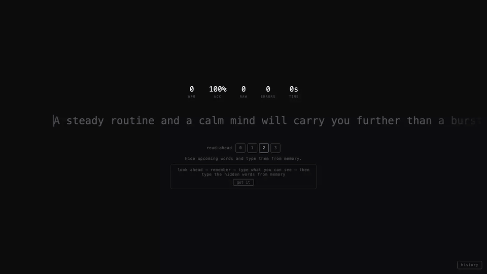
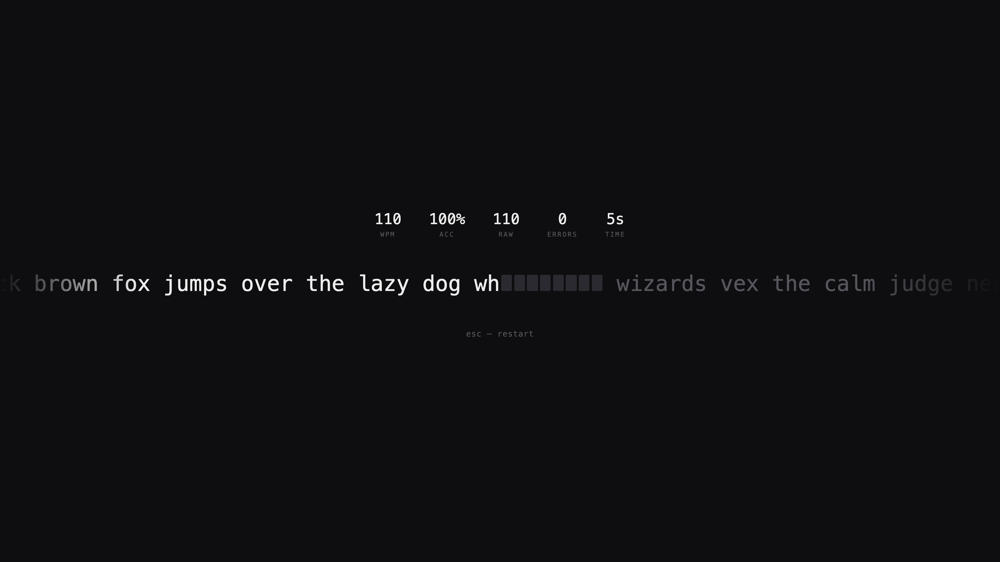
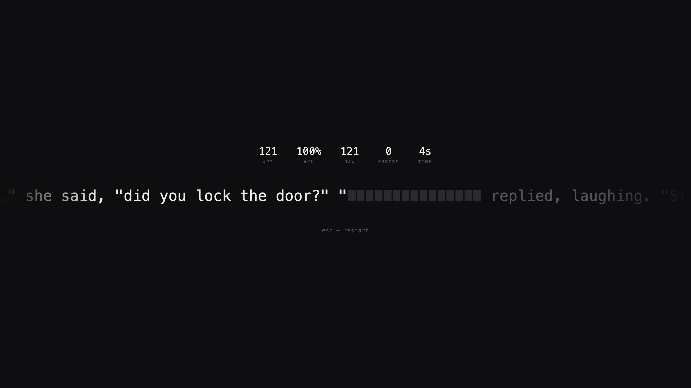
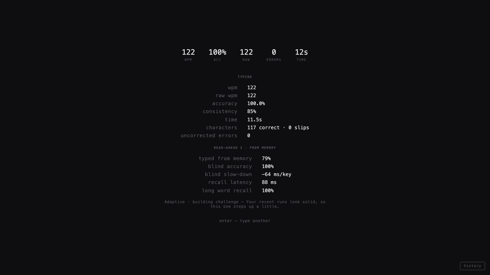
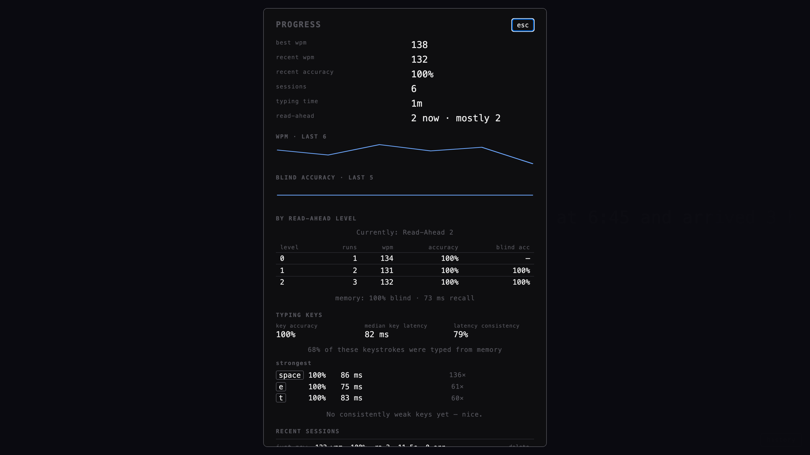
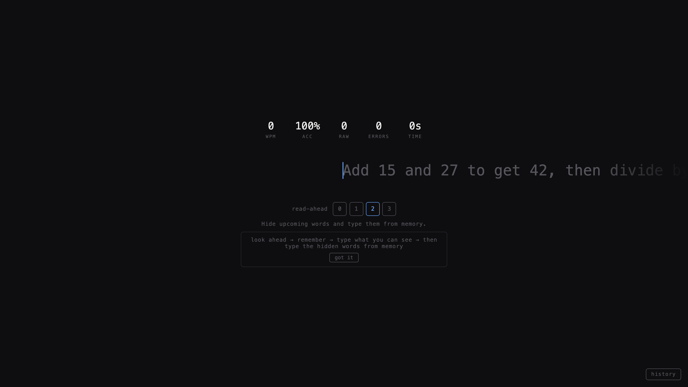

# Type Recall: a read-ahead typing game

**A typing game where the next words disappear. You read them, remember them, and type them from memory.**

**[▶ Play Type Recall on Y8](https://www.y8.com/games/type_recall)** · [Watch the reel](media/typerecall.mp4) · [See it on my portfolio](https://hrishank21s.github.io/#typerecall)

---

## What it is

Type Recall is a browser typing game that trains your memory as well as your speed. A short band of text just ahead of the cursor is hidden. Glance at the next words, start typing, and keep going from memory while they disappear. The further ahead you hide, the more you have to remember.

- **Read-Ahead levels 0 to 3.** Choose how many upcoming words get hidden. Level 0 is a classic typing test.
- **Glimpse, then recall.** Each word is visible until you start it. Your first keystroke hides it, and you finish it blind.
- **Live stats.** WPM, accuracy, raw WPM, errors and time update on every key.
- **A results screen built for memory.** It shows how much you typed from memory, your accuracy while blind, the slow-down when blind, and how long you take to recall a word.
- **Adaptive training.** The next passage is picked from your history to target your weak keys and push you a bit further.
- **Progress panel.** Best and recent WPM, trend charts, stats per Read-Ahead level and per key. All of it is stored locally, with no account needed.

## Screens

| | |
|---|---|
|    **Read-Ahead 2.** The word you are typing and the one after it are hidden. |    **Read-Ahead 3.** A longer stretch to hold in your head. |
|    **Results.** Typing stats plus memory stats. |    **Progress.** Trends, levels and per-key stats from local history. |
|    **Start.** Pick a Read-Ahead level and start typing. | |

## How to play

1. Open the game on [Y8](https://www.y8.com/games/type_recall) and pick a **Read-Ahead** level (start with 1 or 2).
2. Read the words ahead of the cursor, then start typing. The run starts on your first key.
3. Hidden words stay hidden. Type them from memory. A wrong letter can be fixed with Backspace, but the word won't come back.
4. Press **Enter** to play again or **Esc** to restart at any time.

## Specifications

| | |
|---|---|
| Platform | HTML5 browser game, keyboard controlled, published on Y8.com |
| Language | TypeScript, framework-free DOM UI built with Vite |
| Game core | Pure, dependency-free engine: typing model, Read-Ahead concealment, scoring, difficulty and adaptive passage selection |
| Replay | Every run is an event log; all stats can be rebuilt from it exactly |
| Storage | Local history in IndexedDB, no account needed |
| Backend (optional) | Fastify + PostgreSQL API for accounts and sync, which recomputes scores on the server |
| Quality | 229 unit tests (Vitest) plus Playwright end-to-end tests in a real browser |

## About this repository

This is a **showcase** repository: gameplay video, screenshots and the game description. The game's source code is private.
Built by [Hrishank Soni](https://hrishank21s.github.io). More projects are on the [portfolio](https://hrishank21s.github.io) and [GitHub](https://github.com/Hrishank21s).

*Screens and video were captured from a local build with demo runs.*
